<picture>
  <source media="(prefers-color-scheme: dark)" srcset="dark.svg">
  <source media="(prefers-color-scheme: light)" srcset="light.svg">
  
</picture>

  <a href="https://www.linkedin.com/in/habeeb-oyediran">LinkedIn</a> • <a href="https://github.com/habeeboyediran?tab=repositories">Repositories</a>

